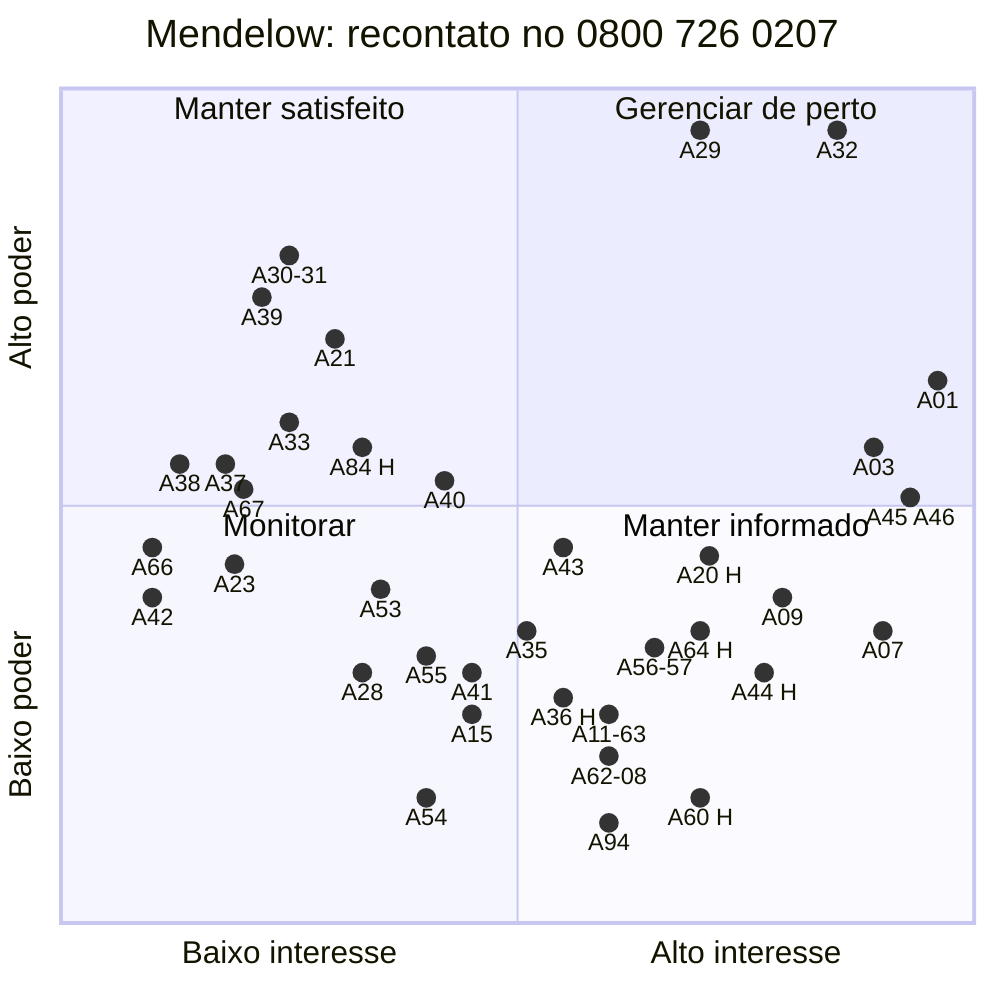

# Mapa de Atores — Seguro-Desemprego (URA CAIXA)

**Jornada:** Atendimento ao Seguro-Desemprego pela URA da CAIXA (0800 726 0207).
**Base de evidência:** `B_relatorio_assistente_v3.md`. Os IDs A·F·P·S·L são os do v3. Os atores novos são numerados a partir de A94.
**Metodologia:** Aula 03 (IDP), "Mapeamento de Atores em Diagnóstico de Serviço Público", pp. 29–46.
**Decisões:** 7 rodadas do /grill-me (Q1–Q29), registradas em `C_grill_transcript.md`. A rodada 7 foi uma revisão crítica com perguntas abertas.

**Resumo:**
- 45 atores nas 7 categorias da aula, mais as vozes críticas; 8 são operadores automatizados (IA/automação).
- Matriz de Mendelow e análise de incentivos.
- Cebola de relações em mermaid, com 5 conflitos e 2 relações propostas.
- RACI atual e RACI-alvo por motivo de ligação.
- 8 atores-chave e 6 hipóteses, sendo H1 a causa raiz, com três causas secundárias.
- Desenho de solução: porta única com delegação de competências e SLA bilateral.

**Legenda de evidência:**
- **[C]** confirmado no v3.
- **[I]** inferido.
- **[H]** ator hipotético, mantido por ser essencial ao propósito.
- **[NV]** não verificado.
- **[P]** proposta de desenho saída do /grill-me; não descreve a situação atual.
- Todas as notas de poder e interesse, a análise de incentivos e as hipóteses são **[I]**.

---

## 1. Propósito e recorte (Passo 0)

**Propósito.** O mapa existe para *reduzir o recontato e o encaminhamento errado no 0800 726 0207, deixando claro quem resolve cada tipo de problema do cidadão.*

O alvo é a *failure demand*: a ligação que só existe porque o primeiro contato falhou (aula, pp. 11–19). É o "jogado de um canal para outro" do meta-prompt (Parte A). O mapa cobre dois subcasos:
- acessibilidade (P05);
- transição do defeso (P06).

**O que o cidadão quer (Q27).** Nas palavras do aluno, o cidadão quer *"atendimento E resolução do seu problema e não apenas ser direcionado para outros lugares"*, além de ver *"intenção real do serviço em atender o seu pedido"*. O segundo motivo relevante de ligação é *retomar uma questão que ficou pendente* em contato anterior. Por isso o mapa mede o serviço por **resolução**, e não por encaminhamento correto.

**Recorte.**
- **Centro:** a URA 0207.
- **Etapas 5–8 da jornada do v3, em detalhe:** consulta, crédito/saque, parcelas seguintes, problema/recurso.
- **Etapas 1–4:** entram só os atores que **originam** ligações à URA (MTE, Dataprev, empregador/eSocial).

**Usuário-referência.** É o **usuário comum (A01)**: o trabalhador formal típico, que faz a maioria das ligações, com celular e algum acesso digital, sem barreira específica. Os subgrupos são recortes de **rota** e de **capacidade de uso da URA**:
- A03, pescador artesanal: rota dupla INSS/MTE;
- A45, idoso ou com baixo letramento digital;
- A46, pessoa surda ou com deficiência de fala.

Doméstico, resgatado e Bolsa Qualificação seguem a mesma rota na URA. O tratamento específico deles no 0207 é [NV] (v3, seção 3).

**Princípio adotado (Q18): o usuário é ator relevante, não só "beneficiário".** A aula põe "cidadãos" em *manter informado* (p. 36), mas a armadilha nº 1 (p. 44) adverte que "suas escolhas — ir pro app ou judicializar — moldam a rede". No processo da ligação, o usuário tem três alavancas reais:
1. **volume e escolha de canal**, porque é ele quem gera a demanda e o recontato;
2. **voz**: reclamação, avaliação e participação, previstas na Lei 13.460/2017;
3. **escalada**: ouvidorias, Procon, DPU, Justiça.

Por isso os usuários ficam em **gerenciar de perto**.

---

## 2. Catálogo de atores (Passo 1)

O catálogo parte do cidadão e se expande em camadas concêntricas (p. 34). "Natureza" separa humanos, IA/automação, instituições e sistemas.

| ID | Ator | Categoria (aula) | Natureza | Visível ao cidadão | Papel no processo da ligação | Evidência |
|---|---|---|---|---|---|---|
| A01 | Usuário comum: trabalhador formal (maioria) | Usuários | Humano | S | Origina e repete a ligação; arca com o custo do recontato | [C] papel · [I] perfil |
| A03 | Pescador artesanal | Usuários | Humano | S | Liga com a rota dependente da data do defeso (INSS legado × MTE) | [C] |
| A45 | Pessoa idosa / baixo letramento digital | Usuários | Humano | S | Depende do telefone e de ajuda de terceiros | [H] barreiras a testar |
| A46 | Pessoa surda ou com deficiência de fala | Usuários | Humano | S | Excluída do canal de voz; precisa de rota equivalente | [C] alternativas divulgadas · [I] barreiras |
| A07 | Atendente CAIXA | Operadores humanos | Humano | S | Atende na central; recebe o recontato; sensor da *failure demand* | [C] · permissões [NV] |
| A20 | Terceirizado de contact center | Operadores humanos | Humano | N | Operação humana da fila, sob contrato e metas | [H] vínculo com o 0207 [NV] |
| A15 | Agências, lotéricas, CAIXA Aqui | Operadores humanos | Humano/canal físico | S | Recebem quem não resolveu cartão, senha ou saque | [C] |
| A11/63 | SRTE e agentes SINE | Operadores humanos | Humano | S | Atendimento presencial do MTE para requerimento e recurso | [C] |
| A62/08 | Intérpretes de Libras + videochamada CAIXA | Operadores humanos | Humano + canal | S | Rota alternativa para A46 | [C] · cobertura do tema [NV] |
| A06 | URA 0800 726 0207 | Operadores automatizados | IA/automação | S | Triagem e consulta de situação; orienta outros canais sem transferência comprovada | [C] · árvore [NV] |
| A50 | Roteamento de chamadas | Operadores automatizados | IA/automação | N | Escolhe a fila ou o autosserviço | [H] |
| A48 | Motor de regras de habilitação | Operadores automatizados | IA/automação | N | Aplica critérios; o resultado vira o motivo da ligação | [C] processamento · desenho [NV] |
| A49 | Controles antifraude e cruzamentos | Operadores automatizados | IA/automação | N | Sinaliza inconsistências; gera suspensão ou exigência | [C] auditados · limiares [NV] |
| A47 | WhatsApp CAIXA | Operadores automatizados | IA/automação | S | Orientação digital alternativa | [C] canal · cobertura [NV] |
| A10 | Alô Trabalho 158 | Operadores automatizados | Canal (URA + atendimento MTE) | S | Destino de "procure o MTE" | [C] |
| A12 | CTD / Emprega Brasil | Operadores automatizados | Sistema | S | Requerimento, consulta, notificação e recurso | [C] |
| A14/91 | CAIXA Tem + Poupança Social Digital | Operadores automatizados | Sistema | S | Conta e app em que o crédito aparece | [C] |
| A29 | MTE (inclui Departamento, CG e Coordenação do SD: A87–A89) | Gestores/Decisores | Institucional | N | Decide a habilitação e o mérito; define motivos e cartas; opera 158 e CTD; contratante da CAIXA | [C] |
| A32 | CAIXA: agente pagador, dona do canal **e gestora da fila 0207** (absorve A58, Q29) | Gestores/Decisores | Institucional | S | Paga; mantém a URA, o roteiro, as filas e as metas; contrata a tecnologia da URA | [C] papel · gestão interna da fila [I] |
| A53 | INSS: defeso legado | Gestores/Decisores | Institucional | S | Trata as coortes anteriores a 01/11/2025 | [C] |
| A39 | TCU | Controle | Institucional | N | Audita o processamento e os pagamentos | [C] |
| A40 | CGU | Controle | Institucional | N | Controle interno; governança das ouvidorias | [C] |
| A37 | MPF / MPT | Controle | Institucional | N | Tutela coletiva quando provocado | [C] competência · nexo [NV] |
| A42 | Banco Central | Controle | Institucional | N | Supervisão bancária; ranking de reclamações | [C] |
| A21 | Dataprev | Fornecedores | Institucional (TI) | N | Processa, cruza e gera os lotes; define quando o status "existe" | [C] |
| A23 | eSocial / Serpro | Fornecedores | Sistema | N | Recebe os eventos laborais do empregador | [C] |
| A28 | Outros bancos | Fornecedores | Institucional | N | Recebem o crédito em conta; ponto do "crédito não localizado" | [C] |
| **A84** | **Fornecedores de tecnologia da URA** (URA, ACD, gravação, TTS, integrações) | Fornecedores | Institucional (TI) | N | **Implementam** a árvore, o roteamento e as integrações que a CAIXA especifica; executam qualquer redesenho | [H] fornecedor e contrato [NV] (v3 L03, L07); incluído na Q26.4 |
| A33 | Empregador, RH e contador | Intermediários | Institucional | N | Originam o dado da dispensa; um erro vira indeferimento | [C] |
| A35 | Sindicatos | Intermediários | Institucional | S | Orientam a base; apoio no 0207 [NV] | [C] papel coletivo |
| A36 | Advogados privados | Intermediários | Humano | S | Escalada judicial | [H] |
| A60 | Familiares | Intermediários | Humano | ? | Ligam pelo titular | [H] |
| A64 | Colônias de pescadores | Intermediários | Institucional | ? | Orientam a coorte do defeso | [H] |
| A44 | Golpistas e falsos intermediários | Intermediários | Humano | N | Exploram a confusão entre canais | [H] incidência [NV] |
| A30/31 | CODEFAT / FAT | Normatizadores/Judiciário | Institucional | N | Normas, prazos e financiamento; **ato normativo da delegação [P]** | [C] |
| A66 | Anatel | Normatizadores/Judiciário | Institucional | N | Tarifa e completamento de 0800/158 | [C] |
| A67 | ANPD | Normatizadores/Judiciário | Institucional | N | Limites ao compartilhamento de contexto entre canais | [C] |
| A38 | Justiça Federal / do Trabalho | Normatizadores/Judiciário | Institucional | N | Decisão em caso individual | [C] |
| A55 | DPU | Normatizadores/Judiciário | Institucional | S | Assistência jurídica a vulneráveis | [C] |
| A09 | SAC e Ouvidoria CAIXA | Vozes críticas | Institucional | S | Recebem as falhas do canal CAIXA | [C] |
| A56/57 | Ouvidoria MTE / Fala.BR | Vozes críticas | Institucional/sistema | S | Recebem as manifestações sobre o MTE | [C] |
| A41 | Senacon / Procons / Consumidor.gov.br | Vozes críticas | Institucional | N | Mediação na esfera bancária | [C] |
| A43 | Mídia e plataformas de relatos | Vozes críticas | Institucional | N | Tornam os casos visíveis | [C] percepção |
| A54 | Pesquisadores, ENAP, Ipea | Vozes críticas | Institucional | N | Avaliação; estudo da fila não encontrado | [I] |
| **A94** | **Vozes ausentes:** conselho de usuários (Lei 13.460), controle social organizado, jornalismo de dados | Vozes críticas | Institucional | — | **Lacuna:** nenhuma atuação ligada ao 0207 encontrada; a ausência é achado (aula, p. 35) | [I] |

**Fora do mapa por decisão.**
- **Q7:** sistemas de baixo nível (A22, A25, A72–A82, A90, A92, A93), A52 (MPA) e A13 (Portal Benefícios), que se sobrepõe a A14.
- **Q29:** A58 (gestor da fila) foi fundido em A32.

Todos continuam no v3.

---

## 3. Matriz de Mendelow (Passo 2)

As notas são de 0 a 1, **subjetivas e justificadas pelo processo da ligação** (Q18):
- **Poder:** o que o ator consegue mudar *antes* (origem da dúvida), *durante* (URA e atendimento) e *depois* (resolução ou encaminhamento).
- **Interesse:** quanto o recontato e o encaminhamento errado o afetam.

O corte entre quadrantes é 0,5. Os 8 operadores automatizados ficam fora da matriz (Q17), porque sistemas não têm interesse. O poder deles é atribuído ao dono:
- A06, A50, A47, A14 → A32, com implementação por A84;
- A48, A49, A12, A10 → A29/A21.

*Rótulos só com o ID; o sufixo `H` marca ator hipotético [H]. Alguns pontos foram deslocados até ±0,04 apenas para não se sobreporem no gráfico. As notas oficiais estão na tabela.*

| Quadrante | Ator | Poder | Interesse | Justificativa (processo da ligação) |
|---|---|---:|---:|---|
| **Gerenciar de perto** | A01 Usuário comum | 0,65 | 1,00 | Origina e repete a ligação; volume e recontato medem o problema; tem voz (Lei 13.460) e escalada; arca com todo o custo |
| | A45 Idoso / baixo letramento [H] | 0,50 | 1,00 | Pouco poder individual, compensado pela proteção legal (Estatuto da Pessoa Idosa); a falha da URA vira demanda presencial e de terceiros |
| | A46 Pessoa surda / def. de fala | 0,50 | 1,00 | A Lei Brasileira de Inclusão exige canal acessível, exigível via MPF/DPU; o canal de voz é excludente |
| | A03 Pescador | 0,50 | 0,95 | Alavancas do usuário, com força coletiva via colônias; rota dupla (P06) |
| | A32 CAIXA (incl. gestão da fila) | 0,95 | 0,85 | Dona do canal, do roteiro, das filas e das metas; absorve as ligações sobre decisões alheias (P01) |
| | A29 MTE | 0,95 | 0,70 | Define regras, motivos, cartas, 158 e CTD; contratante; o custo do 0207 recai na CAIXA |
| **Manter satisfeito** | A30/31 CODEFAT/FAT | 0,80 | 0,25 | Regras e prazos geram dúvidas (P10); fonte do ato normativo da delegação [P] |
| | A39 TCU | 0,75 | 0,25 | Pode impor mudanças por acórdão, mas o foco é pagamento indevido; não interviria no desenho do atendimento (Q26.3) |
| | A21 Dataprev | 0,70 | 0,30 | A latência do status define se a URA "sabe" a resposta (L04) |
| | A33 Empregador | 0,60 | 0,25 | Um dado errado origina o caso (P02); interesse baixo após a dispensa |
| | A84 Fornecedor da URA [H] | 0,55 | 0,35 | Implementa qualquer mudança; pode atrasá-la ou condicioná-la a aditivo; não decide o que muda e ganha com projetos (Q26.5) |
| | A37 MPF/MPT | 0,55 | 0,20 | Uma ação coletiva pode impor acessibilidade ou rota humana |
| | A40 CGU | 0,55 | 0,40 | Supervisiona as ouvidorias e pode recomendar |
| | A38 Justiça | 0,55 | 0,15 | Decide caso a caso, sem efeito sobre o roteiro |
| | A67 ANPD | 0,50 | 0,20 | Limita ou viabiliza o compartilhamento de contexto (S04) |
| **Manter informado** | A07 Atendente | 0,35 | 0,90 | Recebe o recontato; hoje não muda roteiro nem sistema |
| | A09 SAC/Ouvidoria CAIXA | 0,40 | 0,75 | Recebe as falhas; recomenda, não executa |
| | A20 Terceirizado [H] | 0,40 | 0,75 | Contrato e metas regem a conduta da operação humana |
| | A44 Golpistas [H] | 0,30 | 0,75 | A confusão entre canais é o "mercado" deles (P07) |
| | A64 Colônias [H] | 0,35 | 0,70 | Uma informação divergente se multiplica na coorte |
| | A60 Familiares [H] | 0,15 | 0,70 | Ligam pelo titular e herdam a frustração |
| | A56/57 Ouvidoria MTE | 0,35 | 0,65 | Espelho do lado MTE das reclamações |
| | A11/63 SRTE/SINE | 0,25 | 0,60 | Recebem quem a URA manda "procurar o posto" |
| | A62/08 Libras | 0,20 | 0,60 | A rota de A46 depende deles |
| | A94 Vozes ausentes | 0,15 | 0,60 | Interesse por missão; não atuam |
| | A36 Advogados [H] | 0,25 | 0,55 | Ganham com a escalada judicial |
| | A43 Mídia | 0,45 | 0,55 | Expõe casos e pode pautar a gestão |
| | A35 Sindicatos | 0,35 | 0,50 | Orientam a base |
| **Monitorar** | A15 Agências/lotéricas | 0,25 | 0,45 | Recebem quem não resolveu cartão/saque |
| | A41 Procon | 0,30 | 0,45 | Só na parte bancária |
| | A55 DPU | 0,30 | 0,40 | Escalada individual de vulneráveis |
| | A53 INSS legado | 0,40 | 0,35 | Coorte em extinção (out./2026) |
| | A54 Pesquisadores | 0,15 | 0,40 | Sem atuação no 0207 |
| | A28 Outros bancos | 0,30 | 0,35 | Origem do "crédito não localizado" (P03) |
| | A23 eSocial/Serpro | 0,40 | 0,15 | Base do dado do empregador |
| | A42 Bacen | 0,40 | 0,15 | Ranking agregado |
| | A66 Anatel | 0,45 | 0,10 | Tarifa e completamento |

**Nota metodológica.** Antes desta versão foram testados, e descartados, dois critérios (transcript, Q18):
- **Rubrica de alavancas:** descartada porque ainda parecia arbitrária.
- **Índice documental calculado sobre as tabelas do v3:** era reproduzível, mas punha A45, A46 e A44 em "Monitorar". Ele mede quanto o v3 fala de cada ator, não poder real.

Prevaleceu a avaliação subjetiva, justificada ator a ator.

---

## 4. Incentivos e resistências (Passo 3)

O Passo 3 cobre os atores-chave e os de alto poder com influência sobre a URA (Q13, Q26). Todo o conteúdo é [I].

| Ator | Ganha hoje com o serviço quebrado (**manutenção**) | Perderia com a mudança (**resistência**) | Ganharia com a mudança (**alavanca**) |
|---|---|---|---|
| A01 Usuário comum | Nada; no máximo, um canal sem login | O hábito de "ligar para a CAIXA" para tudo | Resolver em 1 contato; acompanhar a pendência por protocolo (Q27) |
| A45 / A46 Vulneráveis | Nada; dependem de terceiros (A60) | Nada relevante | Autonomia e paridade de canal (P05, S05) |
| A03 Pescador | Nada | Nada | Rota certa pela data do defeso (P06, S06) |
| A07 Atendente | Encerrar com "procure o MTE" é rápido | Mais responsabilidade e treinamento com a delegação | Deixar de ser "telefonista" (Q27.3); resolver em vez de repassar |
| A32 CAIXA (incl. gestão da fila) | A URA genérica é barata; "procure o MTE" encerra a chamada; metas de TMA e transbordo cumpridas | Custo de integrar e de assumir protocolos; risco de responder por decisão alheia (C1) | Menos recontato; papel de porta única **com SLA do MTE** no contrato (Q27.5) |
| A29 MTE | **Externalidade:** o custo da dúvida recai na CAIXA | Delegar atos e se obrigar a prazo de mérito (SLA); explicar motivos em linguagem clara | Menos recursos mal direcionados; menos demanda no 158/SRTE |
| A30/31 CODEFAT/FAT | Nada direto | Rever norma para permitir a delegação | Menos parcelas devolvidas ao FAT (F11); programa mais efetivo |
| A21 Dataprev | Contratos de sustentação e evolução | Integração nova = projeto novo e risco de SLA | Contrato de integração (alavanca contratual, aula p. 45) |
| A84 Fornecedor da URA [H] | Contratos de manutenção de uma árvore estável | Redesenho com integração ao MTE exige escopo novo | Aditivo ou projeto de redesenho (alavanca contratual) |
| A33 Empregador | Não retificar o dado não tem custo | Obrigação de correção ágil | Nada direto; precisa de incentivo regulatório |
| A39 TCU *(fora dos atores-chave)* | Controles redundantes "protegem" o pagamento | Nada | Rastreabilidade, se a mudança vier com trilha de auditoria |

**Leitura.** Três fricções estruturais sustentam o recontato:
- **(1) Separação entre recepção e competência:** quem atende (CAIXA) não pode resolver o que é do MTE.
- **(2) Externalidade MTE→CAIXA:** é ela que mantém a separação, porque quem gera a dúvida não paga pelo atendimento dela.
- **(3) Metas de TMA da fila:** recompensam encerrar a chamada, não resolver.

---

## 5. Relações: diagrama de cebola (Passo 4)

O formato segue o GOV.UK (aula, p. 41):
- **Centro:** usuários.
- **Anel 1:** ponto de contato.
- **Anel 2:** decisão, retaguarda e fornecedores.
- **Anel 3:** regras e controle.
- **Faixa lateral:** intermediários e vozes críticas.

Para manter a legibilidade (Q23), o diagrama mostra **só os fluxos e conflitos que tocam os 8 atores-chave**. A relação completa está na tabela abaixo dele.

**Legenda:**
- seta contínua `→`: informação ou decisão;
- seta grossa verde `⇒`: dinheiro;
- seta pontilhada `⇢`: encaminhamento;
- **linha vermelha tracejada `⚡`: conflito**;
- **seta azul tracejada `P`: relação proposta na revisão crítica [P]**;
- borda tracejada: ator hipotético [H] (nos nós agrupados, sufixo `H`);
- borda grossa: ator-chave;
- caixa cinza: atores do anel sem relação desenhada no diagrama (estão na tabela de relações e no catálogo).

```mermaid
flowchart TB
    subgraph LAT["Faixa lateral · Intermediários e vozes críticas"]
        direction LR
        A33["A33 Empregador / RH"]
        A60["A60 Familiares"]
        A44["A44 Golpistas"]
        A09["A09 SAC e Ouvidoria CAIXA"]
        A56["A56/57 Ouvidoria MTE · Fala.BR"]
        GL["Também na faixa:<br/>A35 Sindicatos · A36 Advogados H<br/>A64 Colônias H · A41 Procon<br/>A43 Mídia · A54 Pesquisadores<br/>A94 Vozes ausentes"]
    end

    subgraph R3["Anel 3 · Regras e controle"]
        A30["A30/31 CODEFAT · FAT"]
        A39["A39 TCU"]
        G3["Também no anel 3:<br/>A40 CGU · A37 MPF/MPT · A38 Justiça<br/>A42 Bacen · A66 Anatel<br/>A67 ANPD · A55 DPU"]

        subgraph R2["Anel 2 · Decisão, retaguarda e fornecedores"]
            A29["A29 MTE"]
            A32["A32 CAIXA · agente pagador<br/>e gestora da fila 0207"]
            A84["A84 Fornecedor da URA"]
            A21["A21 Dataprev"]
            A23["A23 eSocial · Serpro"]
            A48["A48 Motor de regras · IA"]
            A28["A28 Outros bancos"]
            G2["Também no anel 2:<br/>A53 INSS defeso legado<br/>A49 Antifraude · IA"]

            subgraph R1["Anel 1 · Ponto de contato"]
                A06["A06 URA 0207 · IA"]
                A07["A07 Atendente CAIXA"]
                A10["A10 Alô Trabalho 158"]
                A12["A12 CTD · Emprega Brasil"]
                A14["A14/91 CAIXA Tem · Poupança"]
                A15["A15 Agências · lotéricas"]
                G1["Também no anel 1:<br/>A50 Roteamento · IA H<br/>A20 Terceirizado H<br/>A47 WhatsApp CAIXA · IA<br/>A62/08 Libras · videochamada<br/>A11/63 SRTE · SINE"]

                subgraph C0["Centro · Usuários"]
                    A01["A01 Usuário comum"]
                    G0["Recortes do usuário:<br/>A03 Pescador<br/>A45 Idoso · baixo letramento H<br/>A46 Surdo · def. de fala"]
                end
            end
        end
    end

    A33 -->|"F01 eventos e requerimento"| A23
    A23 -->|"F03 cruzamentos"| A21
    A01 -->|"F02 pedido"| A12
    A21 -->|"F03 dados"| A48
    A29 -->|"F04 decisão e motivo"| A01
    A29 -->|"F05 lote de parcelas"| A32
    A30 ==>|"F06 R$ FAT"| A32
    A32 ==>|"F07 crédito"| A28
    A32 ==>|"F07 crédito"| A14
    A32 ==>|"F07 saque"| A15
    A32 -->|"F08 status"| A06
    A06 -->|"F08 status"| A01
    A07 -->|"F08 atendimento"| A01
    A06 -.->|"F09 procure o MTE, sem transferência"| A10
    A06 -.->|"F09 orienta"| A12
    A01 -->|"F10 reclamação"| A09
    A01 -->|"F10 manifestação"| A56
    A32 ==>|"F11 devolução 67 dias"| A30
    A30 -->|"F12 normas"| A29
    A39 -->|"F13 acórdãos"| A29
    A32 -->|"F15 pagos e não pagos"| A29
    A32 -->|"R01 árvore e metas da fila"| A06
    A32 -->|"R02 metas TMA"| A07
    A07 -.-|"R03 retorno de motivos AUSENTE"| A32
    A01 -->|"R04 pede ajuda"| A60
    A32 -->|"R09 especifica e contrata"| A84
    A84 -->|"R10 implementa árvore e integrações"| A06
    A29 -.->|"P1 delega atos i e ii + SLA de mérito"| A32
    A30 -.->|"P2 ato normativo da delegação"| A29
    A32 -.-|"⚡ C1 decisão alheia"| A29
    A06 -.-|"⚡ C2 beco sem saída"| A01
    A33 -.-|"⚡ C3 dado divergente"| A01
    A32 -.-|"⚡ C4 TMA x FCR"| A01
    A44 -.-|"⚡ C5 golpe"| A01

    linkStyle 6,7,8,9,17 stroke:#2e8b57,stroke-width:3px
    linkStyle 27,28 stroke:#1f6feb,stroke-width:3px,stroke-dasharray:8 4
    linkStyle 29,30,31,32,33 stroke:#d62728,stroke-width:2px,stroke-dasharray:6 4

    classDef ia fill:#e8f0fe,stroke:#3367d6,color:#111
    classDef hip stroke-dasharray:5 4
    classDef key stroke-width:4px
    classDef grp fill:#f6f6f6,stroke:#999,color:#333
    class A06,A48 ia
    class A60,A44 hip
    class GL,G3,G2,G1,G0 grp
    class A01,A32,A29,A07,A21,A33,A30 key
    style A84 stroke-width:4px,stroke-dasharray:5 4
```

### Relações (tabela completa)

| ID | Origem → destino | Tipo | Descrição | Evidência |
|---|---|---|---|---|
| F01 | A33 → A23 (e Empregador Web) | informação | Eventos laborais e dados do requerimento formal | [C] R07b art. 40, R40 |
| F02 | A01–A46 → A12 / A11-63 | informação | Pedido e documentos conforme modalidade | [C] R04, R13 |
| F03 | A23 → A21 → A48/A49 | informação | Cruzamentos e aplicação de critérios | [C] R10–R11 |
| F04 | A29 → A01 | decisão | Notificação, motivo e possibilidade de revisão | [C] R06–R07b |
| F05 | A29/A21 → A32 | informação | Lote de parcelas emitidas | [C] R07b, R10 |
| F06 | A30/31 → A32 | dinheiro | Financiamento do benefício | [C] R07b arts. 63–65 |
| F07 | A32 → A28 / A14-91 / A15 | dinheiro | Crédito em conta ou saque | [C] R07b art. 20, R62 |
| F08 | A32 → A06/A07 → A01 | informação | Consulta de situação; campos e sincronização [NV] | [C] R02–R03 |
| F09 | A06/A07 → A10 / A12 / A11-63 | encaminhamento | Orientação ao canal competente; **transferência [NV]** | [I] R02, R04–R06 |
| F10 | A01 → A09 / A56-57 | informação | Reclamação segundo o órgão e o objeto | [C] R03, R16–R17 |
| F11 | A32 → A30/31 | dinheiro | Devolução após 67 dias sem saque | [C] R07b art. 21 |
| F12 | A30/31 → A29 / A32 | decisão | Normas de concessão e pagamento | [C] R07b |
| F13 | A39 → A29 | decisão | Determinações e recomendações (Acórdãos 135/2024, 1114/2025) | [C] R10–R11 |
| F14 | A03 → A53 ou A29 | encaminhamento | Rota pela data de início do defeso | [C] R12, R25, R35 |
| F15 | A32 → A29 (via sistema SD) | informação | Pagos e não pagos para gestão e ateste | [C] R07b art. 65 |
| R01 | A32 → A06 / A50 | decisão | Árvore da URA, roteamento e transbordo (gestão da fila, ex-A58) | [I] |
| R02 | A32 → A07 / A20 | decisão | Metas da fila (TMA, transbordo) | [I] L02–L03 |
| R03 | A07 ⇢ A32 / A29 | informação **ausente** | Retorno dos motivos reais das ligações: não documentado (H6) | [I] P08 |
| R04 | A01/A45/A46 → A60 | cooperação | Terceiro liga pelo titular | [I] L06 |
| R05 | A46 → A62/08, A47 | encaminhamento | Rota alternativa ao canal de voz | [C] R14, R36 |
| R06 | A64 / A35 → A03 / A01 | informação | Orientação coletiva | [H][I] |
| R07 | A01 → A38 / A55 / A36 | escalada | Judicialização e assistência jurídica | [C] R27 · [H] A36 |
| R09 | A32 → A84 | contrato | A CAIXA especifica e contrata a tecnologia da URA | [H] L03 |
| R10 | A84 → A06 / A50 | implementação | O fornecedor implementa árvore, roteamento e integrações | [H] L03, L07 |
| **P1** | A29 → A32 | **proposta [P]** | **Delegação** dos atos operacionais (i) e de instrução (ii) + **SLA bilateral**: a CAIXA resolve e acompanha, o MTE decide o mérito no prazo (Q27.4, Q27.5) | [P] · instrumento do contrato 07/2026 não verificado (L10) |
| **P2** | A30/31 → A29 | **proposta [P]** | Ato normativo que autoriza a delegação (Q27.6) | [P] |
| C1 | A32 ⚡ A29 | conflito | A CAIXA atende sobre uma decisão que não é dela (P01). **Com P1, vira obrigação contratual recíproca** | [I] |
| C2 | A06 ⚡ A01 | conflito | Beco sem saída e acesso a humano (Downe #8, #14) | [I] P04 |
| C3 | A33 ⚡ A01 | conflito | Dado divergente ou omitido trava a habilitação (P02) | [C] achado TCU · [I] nexo |
| C4 | A32 (fila) ⚡ A01 | conflito | Metas de TMA × resolução no primeiro contato | [I] L02–L03 |
| C5 | A44 ⚡ A01 | conflito | Exploração da confusão entre canais (P07) | [H] incidência [NV] |

---

## 6. RACI por motivo de ligação

As linhas são os **motivos pelos quais o cidadão liga** (Q11). Legenda:
- **A:** responde pelo resultado;
- **R:** executa;
- **C:** é consultado;
- **I:** é informado.

C e I são [I], salvo quando há fluxo explícito no v3.

### 6.1 RACI atual (como o serviço funciona hoje, segundo o v3)

| # | Motivo da ligação | A | R | C | I | O que acontece hoje |
|---|---|---|---|---|---|---|
| **0** | **Passagem entre canais** (CAIXA → MTE/158/CTD) | **⚠ ausente** | A06, A07 (só orientam) | A10 | A01 | "Procure o MTE", sem transferência nem protocolo (F09, P04) |
| 1 | Status da parcela | A32 | A06, A07 | A21, A29 | A01 | Consulta na URA; vocabulário do status ambíguo (P03) |
| 2 | Crédito não localizado | A32 | A07 | A28, A14/91 | A01, A29 (F15) | Atendente CAIXA; banco recebedor |
| 3 | Cartão / senha / saque | A32 | A15, A07 | A14 | A01 | Agência/lotérica ou CAIXA Tem |
| 4 | Indeferimento / suspensão / revisão | A29 | A29 via A12, A11/63 | A48, A49, A21 | A32, A01 | O cidadão é mandado ao MTE (CTD, 158, SRTE/SINE) |
| 5 | Dado do empregador divergente | A29 | A33 (retifica via A23) | A21 | A01 | O cidadão é mandado ao empregador e ao MTE |
| 6 | Defeso legado | A53 ou A29 (pela data) | idem | A64 | A03 | A rota depende da data do defeso (P06) |
| 7 | Atendimento acessível | A32 | A62/08, A47 | A32 (gestão da fila) | A45, A46 | Videochamada em Libras / WhatsApp; equivalência [NV] |
| 8 | Reclamação do canal | A32 (CAIXA) / A29 (MTE) | A09 / A56-57 | A07 | A01 | SAC/Ouvidoria do órgão dono do objeto |
| 9 | Suspeita de golpe | A32 | A09, A07 | A29 | A01 | SAC CAIXA + canais oficiais |
| 10 | Retomar pendência de contato anterior | **⚠ ausente** | — | — | A01 | Sem protocolo comum: o cidadão recomeça do zero (P04, L01) |

### 6.2 RACI-alvo [P] (desenho decidido na revisão crítica, Q27)

**Princípio:** *resolver, não encaminhar.* A **CAIXA é a porta única com protocolo**:
- executa os **atos operacionais (i)** e de **instrução (ii)**, por **delegação** do MTE;
- o **mérito (iii)** permanece com o MTE, sob **SLA** no contrato MTE–CAIXA.

| # | Motivo da ligação | A | R | C | I | Resolve no 1º contato? |
|---|---|---|---|---|---|---|
| **0** | **Demanda de competência do MTE** (ex-"passagem entre canais") | **A32** (protocolo e continuidade) | A06/A07 abrem o protocolo | A29 | A01 | **Sim**: abre a demanda, informa número e prazo; acaba o "procure o MTE" |
| 1 | Status da parcela | A32 | A06, A07 | A21 | A01 | Sim, com vocabulário convergente de status (H1a, S03) |
| 2 | Crédito não localizado | A32 | A07 | A28 | A01 | Sim: rastreio do envio |
| 3 | Cartão / senha / saque | A32 | A07, A15 | A14 | A01 | Sim para desbloqueio (ato i); presencial só se exigir identificação |
| 4 | Indeferimento / suspensão / revisão | **A32** na instrução (ii) · **A29** no mérito | A07 explica o motivo e registra o recurso; A29 decide no SLA | A48, A49, A21 | A01 | **Parcial**: explicação e recurso no 1º contato; decisão no prazo contratual |
| 5 | Dado do empregador divergente | **A32** na instrução (ii) · **A29** no mérito | A07 solicita a retificação; A33 retifica via A23 | A21, A29 | A01 | **Parcial**: o pedido de correção sai do 1º contato |
| 6 | Defeso legado | A53 ou A29 (pela data) | A07 identifica a coorte e abre o protocolo | A64 | A03 | Parcial; delegação ao INSS legado não discutida [NV] |
| 7 | Atendimento acessível | A32 | A62/08, A47 | — | A45, A46 | Sim, pela rota equivalente (H1b, S05) |
| 8 | Reclamação do canal | A32 / A29 | A09 / A56-57 | A07 | A01 | n/a: canal de 2ª instância |
| 9 | Suspeita de golpe | A32 | A09, A07 | A29 | A01 | Sim: orientação e bloqueio preventivo |
| **10** | **Retomar pendência anterior** | **A32** (dona do protocolo) | A06/A07 consultam o protocolo | A29 (status do mérito sob SLA) | A01 | **Sim**: o cidadão informa o protocolo e recebe a situação, sem recomeçar |

**O que muda da RACI atual para a RACI-alvo.**
- As duas linhas sem dono (0 e 10) passam a ser da CAIXA.
- Nas linhas 4 e 5, o "A" se divide em **instrução (CAIXA)** e **mérito (MTE)**.
- O risco que sobra é o protocolo parado no MTE, e é ele que justifica o **SLA bilateral** (Q27.5).

---

## 7. Atores-chave e hipóteses de diagnóstico (Passo 5)

**Critério (Q26).** É ator-chave quem *pode impedir ou dificultar a mudança* ou *é parte essencial da operação*.

| # | Ator | Critério | Por que é chave |
|---|---|---|---|
| 1 | **A01 Usuário comum** (recortes A45, A46, A03) | Operação | Ponto focal; seu recontato é a medida do problema |
| 2 | **A07 Atendente** | Operação | Passa de "telefonista" a resolutor com a delegação (Q27.3) |
| 3 | **A32 CAIXA** (incl. gestão da fila) | Veto de fato + operação | Dona da central multisserviço; pode deixar de priorizar a mudança (Q26.2); seria a porta única |
| 4 | **A29 MTE** | Veto + operação | Dono do mérito e do contrato; precisa delegar e aceitar o SLA |
| 5 | **A21 Dataprev** | Veto (integração) | Status, motivo e protocolo dependem da integração |
| 6 | **A84 Fornecedor da URA [H]** | Executa o desenho | Implementa a árvore e as integrações; pode atrasar ou condicionar (Q26.4) |
| 7 | **A33 Empregador** | Peça fundamental | Origem do dado divergente (H4) |
| 8 | **A30/31 CODEFAT** | Veto normativo | Ato que autoriza a delegação (Q27.6) |

**Ficam fora, por decisão do aluno.**
- **TCU:** *"não viria a intervir nesse particular de desenho de processos internos"* (Q26.3, mantido na Q27.6).
- **ANPD:** *"muito distante"*.
- **Gestor da fila (ex-A58):** fundido na CAIXA (Q29).
- **Terceirizado de operação humana (A20):** substituído por A84 (Q26.4).

**Hipóteses.** Cada uma responde à pergunta: "como a posição e os incentivos desses atores mantêm a demanda falha?". O indicador vem do framework de métricas da aula (pp. 20–25).

| # | Hipótese | Atores | Indicador para testar | Dimensão | Vínculos (v3) |
|---|---|---|---|---|---|
| **H1** | **Causa raiz (reformulada na Q28):** quem recebe a demanda (CAIXA/URA) não tem competência para resolvê-la (MTE). O 1º contato termina em "procure o MTE", e o cidadão volta a ligar. A **externalidade de custo** (o MTE não paga pela dúvida que gera) é o mecanismo que mantém essa separação. | A32, A29, A01, A07 | Recontato em 7 dias nos motivos 4, 5 e 10 | Volume / *failure demand* | P01, P04, S01, S04; RACI linhas 0 e 10 |
| H1a | *Causa secundária:* linguagem das cartas e dos status | A29, A32, A21 | Recontato após notificação; compreensão em teste com usuários | Qualidade | P03, P10, S03, S09 |
| H1b | *Causa secundária:* dificuldade de chegar a um atendente humano | A32, A84, A06 | Tempo até o humano; abandono na URA | Acesso | P04, P05, L01 |
| H1c | *Causa secundária:* o menu não pergunta qual é o problema (sem triagem por objeto) | A32, A84, A06 | % de chamadas transferidas ou repetidas por classificação errada | Qualidade | S01, L01 |
| **H2** | As metas de TMA e transbordo da fila da CAIXA favorecem encerrar em vez de resolver | A32 (fila), A07, A20 | FCR × TMA por motivo | Qualidade / resolução | L02, L03, S08 |
| **H3** | A defasagem e o vocabulário do status (emitida / enviada / creditada) fazem a URA responder sem fechar a dúvida | A21, A29, A32 | Tempo entre o lote e o status na URA; recontato nos motivos 1 e 2 | Eficiência temporal | P03, L04, S03, F15 |
| **H4** | Um dado divergente do empregador gera indeferimento cujo motivo não chega à URA | A33, A29, A01 | % de indeferimentos por divergência que geram ligação ao 0207 | Custo / retrabalho | P02, S02 |
| **H5** | Uma URA só de voz, com autenticação, exclui A45/A46: eles dependem de terceiros (A60) e ficam expostos a golpistas (A44) | A01 (recortes), A32 | Abandono e conclusão por perfil e canal | Acesso / inclusão | P05, P07, S05, S07 |
| **H6** | O atendente percebe os motivos reais, mas não há retorno até a gestão da fila (A32) e o MTE; o problema fica invisível nos painéis | A07, A32, A29 | Taxonomia de motivos e % de ligações classificadas | Volume (3 principais motivos) | P08, S08, L05 |

Depois da fusão da Q29, H2 e H6 apontam para a CAIXA como um todo. Elas ficam mais robustas, porque o ator existe, e menos específicas, porque não identificam a unidade interna. Ambas dependem de L02 e L05.

---

## 8. Desenho de solução decorrente da revisão crítica [P]

A revisão crítica (rodada 7) converteu a H1 em uma proposta. Nas palavras do aluno: *"não é razoável que um agente destinado a receber as demandas não possa ser capaz de resolvê-las, viraria apenas uma telefonista… Se o problema é competência, que haja a delegação de competências."*

| Elemento | Decisão | Atores que precisam agir | Risco / lacuna |
|---|---|---|---|
| Porta única com protocolo | A CAIXA recebe, resolve ou abre a demanda e acompanha até o fim (Q27.1) | A32, A84 (implementa), A21 (integra) | Integração do protocolo com o MTE (L02, L04) |
| Delegação de competências | Atos operacionais (i) e de instrução (ii) passam ao gestor da URA; o mérito (iii) fica no MTE (Q27.4) | A29 (delega), A30/31 (ato normativo, Q27.6) | Base normativa a definir; responsabilidade por erro de instrução |
| SLA bilateral | Prazo de mérito do MTE e de resolução da CAIXA no contrato MTE–CAIXA (Q27.5): *"seria uma inovação formidável"* | A29, A32 | **Lacuna crítica L10:** instrumento do contrato 07/2026 e obrigações sobre o 0207 não verificados |
| Causas secundárias | Linguagem (H1a), acesso a humano (H1b) e triagem por objeto (H1c) entram na mesma solução (Q28) | A29, A32, A84 | Exigem teste com usuários (L01, L06) |
| Atendente como resolutor | O papel muda de "telefonista" para quem resolve e instrui | A07, A32 | Treinamento, permissões e metas (H2) |

**Riscos remanescentes.**
- **Protocolos parados no MTE:** sem SLA efetivo, o recontato reaparece como cobrança.
- **C1 continua existindo:** passa de conflito difuso a obrigação contratual recíproca, e por isso exige fiscalização do contrato.
- **Veto de fato da CAIXA (Q26.2):** pode adiar a mudança. A alavanca é o contrato com o MTE.

---

## 9. Checagem das armadilhas (aula, p. 44) e lacunas herdadas

| Armadilha | Como este mapa a trata |
|---|---|
| Esquecer o cidadão | Usuário no centro da cebola, em *gerenciar de perto* e entre os atores-chave; a solução parte do que ele quer (Q27) |
| Ignorar intermediários | 6 intermediários, inclusive golpistas e familiares; empregador como ator-chave |
| Descartar órgãos de controle | TCU, CGU e MPF/MPT no anel 3. O TCU ficou fora dos atores-chave **por decisão justificada** (Q26.3), não por omissão |
| Confundir com organograma | A29 consolida A87–A89; o mapa mostra influência real: externalidade, metas, contrato e conflitos C1–C5 |
| Tratar o mapa como peça fixa | A rodada 7 revisou o mapa já pronto (atores-chave, RACI, H1); atores [H] seguem com validação pendente |
| Excluir vozes críticas | 5 vozes críticas + A94 "vozes ausentes" como achado |

**Lacunas do v3 que afetam este mapa.**
- **L01:** árvore real da URA, transferência e protocolo. Base para as RACIs atual e alvo e para H1b e H1c.
- **L02, L03:** metas da fila, terceirização, fornecedor da URA (A84) e permissões do atendente. Validam H2, H6, A84 e o desenho do atendente resolutor.
- **L04:** dicionário de status e latência. Valida H3 e H1a.
- **L05:** série de motivos, recontato e desfecho por fila. É a base dos indicadores de H1–H6.
- **L06:** acessibilidade, custo do 158 e representação por familiares. Valida H5.
- **L09:** prazos de recurso divergentes. Afeta a linha 4 da RACI-alvo.
- **L10 (crítica para a solução):** instrumento e anexos do contrato MTE–CAIXA 07/2026. Sem eles, não se sabe se a delegação e o SLA cabem por aditivo ou exigem novo instrumento.
